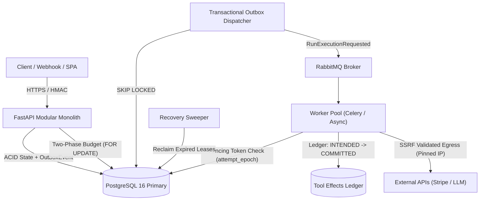

# FlowForge: Resilient AI Agent & Durable Workflow Automation Platform

FlowForge is an enterprise-grade AI agent and durable workflow automation engine engineered in Python, FastAPI, and PostgreSQL. It delivers fault-tolerant, multi-step agent orchestration with mathematical correctness guarantees: **zero duplicate external side effects**, **zombie worker fencing**, **transactional outbox delivery**, **two-phase budget reservations**, **SSRF egress defense with IP pinning**, and **human-in-the-loop governance**.

---

## 1. Release Gates Verification Matrix (G1–G6)

Every release gate in FlowForge is backed by verifiable automated test suites and architectural documentation:

| Release Gate | Verification Scope | Concrete Repository Evidence & Automated Tests | Status |
|---|---|---|---|
| **G1: Specification** | PRD + OpenAPI + test contracts define allowed & forbidden behaviors | [`docs/00-problem.md`](docs/00-problem.md), [`spec/00-global.md`](spec/00-global.md), [`openapi.json`](openapi.json), `tests/unit/test_phase1_sanity.py` (`P1-T15`) | **PASSED** |
| **G2: Data Correctness** | Relational state machines, check constraints, published version immutability, optimistic concurrency | `alembic/versions/0001..0007`, `tests/integration/test_state_machine.py` (`P2-T19..T23`), `tests/unit/test_dag_validation.py` (`P3-T11`), `tests/integration/test_runs_execution.py` (`P4-T10..T11`), `tests/integration/test_openrouter_integration.py` (`P7-T05`) | **PASSED** |
| **G3: Security** | Cross-tenant isolation (BOLA), SSRF egress blocklist & IP pinning, HMAC-SHA256 webhooks, two-phase budget reservation | [`docs/threat-model.md`](docs/threat-model.md), `tests/security/` (`P9-T01..P9-T08`, `P2-T10`, `P6-T09`, `P7-T06`), `scripts/check_tenant_params.py` | **PASSED** |
| **G4: Recovery** | Kill-worker mid-step recovery with zero duplicate side-effects, duplicate replay no-ops, timed DB restore | [`docs/failure-recovery.md`](docs/failure-recovery.md), `tests/integration/test_sweeper_recovery.py` (`P5-T06..T11`), `tests/e2e/test_kill_worker_recovery.py` (`P10-T01..T02`), [`docs/lab-notes/restore-drill-report.md`](docs/lab-notes/restore-drill-report.md) | **PASSED** |
| **G5: Operations** | Prometheus metrics, OpenTelemetry distributed tracing, circuit breaker trips, 8 runbooks, blameless postmortem | `infra/observability/`, `docs/runbooks/01..08`, [`docs/postmortems/PM-001-worker-lease-stall.md`](docs/postmortems/PM-001-worker-lease-stall.md), `tests/integration/test_observability.py` (`P8-T02..T04`) | **PASSED** |
| **G6: Communication** | Architecture decision records with rejected alternatives, C4 diagrams, 10× scaling proposal, engineering case study | `docs/adr/ADR-001..005`, [`docs/architecture/diagrams.md`](docs/architecture/diagrams.md), [`docs/architecture/10x-scaling-proposal.md`](docs/architecture/10x-scaling-proposal.md), [`docs/case-study.md`](docs/case-study.md) | **PASSED** |

---

## 2. Architecture & Durability Mechanics



### Core Invariants
1. **Transactional Outbox (`outbox_events`):** Eliminates dual-write desynchronization between database updates and message broker dispatch.
2. **Fencing Tokens (`attempt_epoch`):** Every lease acquisition monotonically increments `attempt_epoch`. Obsolete or delayed worker commits fail atomically.
3. **Tool-Effects Ledger (`INTENDED` -> `COMMITTED`):** External side effects record deterministic idempotency keys before execution. On crash recovery, already-committed steps are skipped without duplicate calls.
4. **SSRF Validator with IP Pinning:** External HTTP tools inspect destination URLs against 15 blocked RFC CIDR ranges, resolve all DNS addresses, pin connections to the validated IP, and enforce TLS `sni_hostname`.
5. **Two-Phase Budget Reservation:** Acquires `SELECT FOR UPDATE` row locks on the organization record, reserves worst-case token costs in `budget_reservations`, and settles actual micro-USD costs upon step completion.

---

## 3. Quick Start

### Prerequisites
- **Docker & Docker Compose** (PostgreSQL 16, RabbitMQ 3.13)
- **Python 3.12+** (Python 3.14 recommended)
- **Node.js 20+** and `npm`

### Local Development Setup

#### 1. Start Infrastructure Services
```bash
docker compose up -d postgres rabbitmq
```

#### 2. Install Python Virtual Environment & Dependencies
```bash
python3 -m venv .venv
source .venv/bin/activate
pip install -r requirements.txt -r requirements-dev.txt
pip install -e .
alembic upgrade head
```

#### 3. Start Backend Services
```bash
# Terminal 1: FastAPI API Server
uvicorn app.main:create_app --factory --reload --host 127.0.0.1 --port 8000

# Terminal 2: Background Worker Fleet
celery -A app.workers.celery_app worker -l info -c 4

# Terminal 3: Outbox Publisher & Recovery Sweeper
python -m app.workers.scheduler
```

- API Base URL: `http://localhost:8000`
- Swagger UI Documentation: `http://localhost:8000/docs`
- Prometheus Metrics: `http://localhost:8000/metrics`
- Readiness Probe: `http://localhost:8000/v1/health/ready`

#### 4. Start Frontend Application
```bash
cd frontend
npm install
npm run dev
```
- Frontend UI: `http://localhost:5173`

---

## 4. API Usage Examples

### 1. User Signup & Authentication
```bash
curl -X POST http://localhost:8000/v1/auth/signup \
  -H "Content-Type: application/json" \
  -d '{
    "email": "operator@example.com",
    "password": "Password123456!",
    "display_name": "Lead Operator"
  }'
# Returns access_token in response JSON
```

### 2. Create Organization & Store Integration Credential
```bash
# Create Organization
curl -X POST http://localhost:8000/v1/organizations \
  -H "Authorization: Bearer ${ACCESS_TOKEN}" \
  -H "Content-Type: application/json" \
  -d '{"name": "Acme Corp"}'

# Store Encrypted Stripe Credential with Host Allowlist
curl -X POST http://localhost:8000/v1/organizations/${ORG_ID}/credentials \
  -H "Authorization: Bearer ${ACCESS_TOKEN}" \
  -H "Content-Type: application/json" \
  -d '{
    "name": "stripe_billing",
    "provider": "stripe",
    "secret": "sk_test_51Mz...",
    "allowed_hosts": ["api.stripe.com"]
  }'
```

### 3. Create & Publish Workflow Definition
```bash
# Create Workflow Draft
curl -X POST http://localhost:8000/v1/organizations/${ORG_ID}/workflows \
  -H "Authorization: Bearer ${ACCESS_TOKEN}" \
  -H "Content-Type: application/json" \
  -d '{"display_name": "Customer Support Refund Flow"}'

# Submit Version Draft with DAG Steps
curl -X POST http://localhost:8000/v1/workflows/${WORKFLOW_ID}/versions \
  -H "Authorization: Bearer ${ACCESS_TOKEN}" \
  -H "Content-Type: application/json" \
  -d '{
    "definition": {
      "schema_version": 1,
      "name": "Refund Flow",
      "inputs_schema": {"type": "object", "required": ["customer_id", "amount"]},
      "start": "review_refund",
      "steps": [
        {
          "id": "review_refund",
          "type": "approval",
          "config": {
            "assigned_role": "admin",
            "timeout_seconds": 3600,
            "summary_template": "Refund {{ inputs.amount }} to {{ inputs.customer_id }}"
          },
          "next": "execute_charge"
        },
        {
          "id": "execute_charge",
          "type": "http_request",
          "config": {
            "method": "POST",
            "url": "https://api.stripe.com/v1/charges",
            "credential_id": "'"${CRED_ID}"'",
            "effect": "write"
          },
          "next": null
        }
      ]
    }
  }'

# Publish Version (Locks Immuntability Checksum)
curl -X POST http://localhost:8000/v1/workflows/${WORKFLOW_ID}/publish \
  -H "Authorization: Bearer ${ACCESS_TOKEN}"
```

### 4. Trigger Run & Approve Pending Request
```bash
# Trigger Workflow Run
curl -X POST http://localhost:8000/v1/workflows/${WORKFLOW_ID}/runs \
  -H "Authorization: Bearer ${ACCESS_TOKEN}" \
  -H "Content-Type: application/json" \
  -d '{"customer_id": "cus_123", "amount": 250}'
# Returns HTTP 202 Accepted {"run_id": "..."}

# List Pending Approvals
curl -X GET "http://localhost:8000/v1/organizations/${ORG_ID}/approvals?state=PENDING" \
  -H "Authorization: Bearer ${ACCESS_TOKEN}"

# Submit Human Decision
curl -X POST http://localhost:8000/v1/approvals/${APPROVAL_ID}/decide \
  -H "Authorization: Bearer ${ACCESS_TOKEN}" \
  -H "Content-Type: application/json" \
  -d '{"decision": "APPROVED", "reason": "Verified invoice claim"}'
```

---

## 5. Recovery Drills & Benchmark Commands

FlowForge includes fully automated recovery drills and reproducible synthetic load benchmarks:

```bash
# 1. Kill-Worker Crash Recovery Drill (P10-S01)
python scripts/drills/kill_worker_demo.py

# 2. Timed PostgreSQL Backup & Restore Drill (P10-S02)
bash scripts/drills/backup_restore_drill.sh

# 3. 50-Client Concurrent API Load Benchmark (P10-S03)
python scripts/load/benchmark_api.py --duration 10.0
```

### Measured Evidence Summary
- **Kill-Worker Mid-Step Crash:** Worker 1 killed via `SIGKILL` during step transition. Sweeper rescued stale lease; Worker 2 resumed at `attempt_epoch = 2`. **Zero duplicate side-effects** (exactly 1 external wire call per step).
- **PostgreSQL Disaster Recovery RTO:** **0.354 seconds** to provision target DB, restore dump, and verify bit-for-bit row count parity across 15 tables.
- **API Load Performance:** **275.45 req/sec** sustained over 50 concurrent client workers, **p50 latency 121.58 ms**, **p99 latency 419.82 ms**, **0.00% HTTP error rate**.

---

## 6. Verification & Test Suite Execution

```bash
# Run all 240+ unit, integration, and security tests
pytest -q

# Run security test suite (SSRF, Budget Races, HMAC, Rate Limiting, BOLA)
pytest tests/security/ -v

# Run E2E recovery drill test
pytest tests/e2e/test_kill_worker_recovery.py -v

# Static analysis and strict typechecking
ruff check .
ruff format --check .
mypy app
python scripts/check_tenant_params.py

# Frontend linting, typecheck, unit tests, and production build
cd frontend && npm run lint && npm run typecheck && npm test && npm run build
```

---

## 7. Operational Runbooks & Architecture

- **Operational Runbooks (`docs/runbooks/`):**
  - [Runbook 01: Provider 429 Storm & Circuit Breaker](docs/runbooks/01-provider-429-storm.md)
  - [Runbook 02: Stuck Running Task & Expired Worker Leases](docs/runbooks/02-stuck-running-task.md)
  - [Runbook 03: Approval Expired Triage](docs/runbooks/03-approval-expired.md)
  - [Runbook 04: Webhook Signature Mismatch](docs/runbooks/04-webhook-signature-mismatch.md)
  - [Runbook 05: Queue Saturation & Outbox Lag](docs/runbooks/05-queue-saturation.md)
  - [Runbook 06: Secret Compromise & Emergency Key Rotation](docs/runbooks/06-secret-compromise.md)
  - [Runbook 07: Billing Overspend & Budget Exhaustion](docs/runbooks/07-billing-overspend.md)
  - [Runbook 08: Database Restore & Outbox Reconciliation](docs/runbooks/08-db-restore.md)
- **Incident Postmortem:** [`docs/postmortems/PM-001-worker-lease-stall.md`](docs/postmortems/PM-001-worker-lease-stall.md)
- **10× Scaling Proposal:** [`docs/architecture/10x-scaling-proposal.md`](docs/architecture/10x-scaling-proposal.md)
- **Architecture Diagrams (C4 & Sequence):** [`docs/architecture/diagrams.md`](docs/architecture/diagrams.md)
- **Engineering Case Study:** [`docs/case-study.md`](docs/case-study.md)

---

## 8. Honest Portfolio Caveats & Known Limits

In accordance with honest distributed systems engineering:
1. **Single-Region Primary Database:** Current architecture utilizes a single PostgreSQL primary. Cross-region multi-master active-active replication is not supported.
2. **Synchronous Tool Socket Allocation:** Long-running external HTTP tool calls consume a worker coroutine socket until completion or timeout (default 30s) rather than parking state to disk.
3. **Approval Expiration Semantics:** When an approval request exceeds its configured TTL, the run fails permanently with `APPROVAL_EXPIRED`. Resumption requires triggering a new run; in-place resurrecting of expired approvals is intentionally forbidden by state machine invariants.
