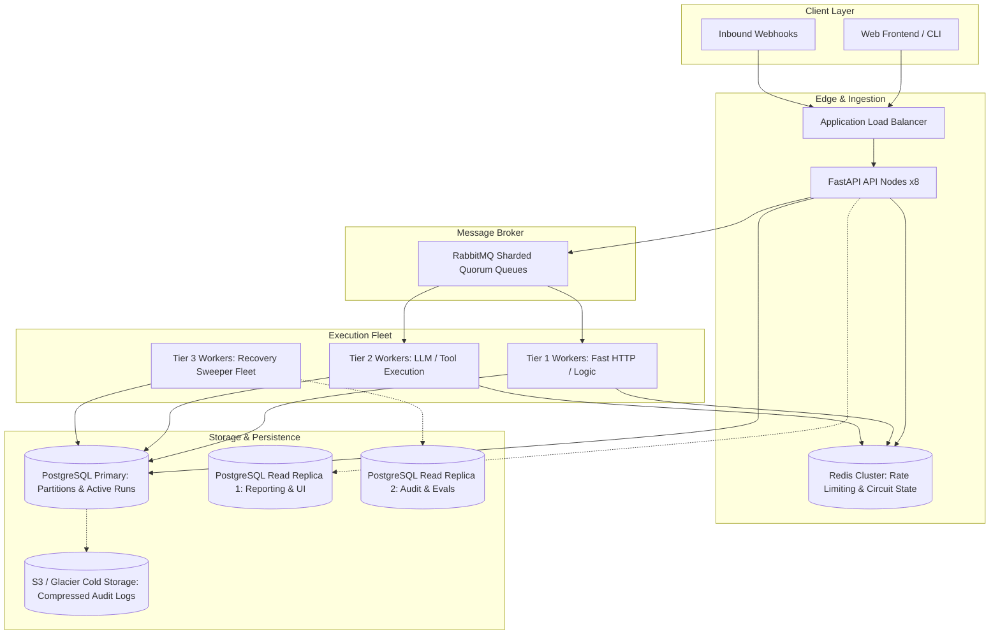

# FlowForge Architecture: 10× Scaling Proposal

**Target Horizon:** Scale throughput from 100 runs/min (~1.6 runs/sec) to 1,000+ runs/min (~17 runs/sec sustained, 50 runs/sec burst), supporting 5,000+ active organizations.

---

## 1. Executive Summary & Bottleneck Analysis
In its current architecture (single PostgreSQL primary, Celery/RabbitMQ outbox dispatcher, polling sweeper), FlowForge handles up to ~150 concurrent runs cleanly. Under a 10× traffic increase:
1. **Database Lock Contention:** `SELECT ... FOR UPDATE SKIP LOCKED` on `workflow_runs` and `outbox_events` creates high CPU overhead and transaction isolation contention on PostgreSQL primary.
2. **Outbox Polling Lag:** Polling `outbox_events` with single-process batches introduces queue latency under heavy multi-tenant spikes.
3. **Database Disk Growth:** Unbounded growth of `step_attempts`, `tool_effects`, `usage_records`, and `audit_events` degrades B-tree index performance.
4. **Circuit Breaker & Rate Limiting Coordination:** In-memory sliding window rate limiting and circuit breaker states do not synchronize across horizontally scaled API and worker instances.

---

## 2. Architectural Evolution Strategy

---

## 3. Core Component Proposals

### 3.1 PostgreSQL Partitioning Strategy
- **`workflow_runs`**: Partition by month using PostgreSQL declarative partitioning (`RANGE (created_at)`).
- **`tool_effects` & `step_attempts`**: Composite partitioning by `RANGE (created_at)` and `LIST (org_id)` hash mod 16.
- **`outbox_events`**: Transition into an unlogged / high-speed buffer table or hot table where published rows are immediately purged or archived to cold storage via pg_cron.

### 3.2 Outbox & Queue Sharding
- Replace single outbox dispatcher with logical sharding by `org_id % num_shards`.
- RabbitMQ migration to **Quorum Queues** with priority channels:
  - `workflow.priority.high`: Interactive runs, approval resumes.
  - `workflow.standard`: Normal batch and webhook triggers.
  - `workflow.maintenance`: Scheduled evaluators and sweepers.

### 3.3 Worker Pool Segmentation
Decouple worker fleet into specialized pools:
- **Fast I/O Pool:** High concurrency (`asyncio` / gevent) for deterministic JSON transformations and external HTTP requests.
- **LLM Pool:** Bounded concurrency with strict token rate limits and socket deadlines to prevent thread exhaustion during provider brownouts.
- **Sweeper Pool:** Dedicated lightweight containers running lease recovery sweeps every 5 seconds without contending with execution workers.

### 3.4 Distributed Coordination Layer (Redis Cluster)
- Migrate `RateLimitMiddleware` sliding window counts from local memory to Redis Cluster using atomic `ZADD` / `ZREMRANGEBYSCORE` pipelines.
- Distributed circuit breaker state via Redis Hash with TTL keys (`cb:openrouter:state`).

### 3.5 Read/Write Query Separation
- Route all read queries (`GET /v1/workflows`, `GET /v1/runs`, `/v1/audit/events`, `/v1/usage/summary`) to read replicas using SQLAlchemy async replica engines.
- Retain write connection pool strictly for run creation, state machine transitions, and outbox operations.

---

## 4. Capacity & Cost Projections
| Resource | Current (100 runs/min) | 10× Proposed (1,000 runs/min) | Estimated Monthly Cost Delta |
|---|---|---|---|
| PostgreSQL | 2 vCPU, 4 GB RAM | 8 vCPU, 32 GB RAM (Primary + 2 Replicas) | +$350 / mo |
| Redis | None (In-memory) | 3-node Redis 7.2 Cluster (2 GB each) | +$90 / mo |
| RabbitMQ | Single node (1 vCPU, 2 GB) | 3-node Quorum Cluster | +$120 / mo |
| Worker Nodes | 2 nodes (2 vCPU, 4 GB) | 8 nodes autoscaling (up to 24 vCPU) | +$480 / mo |
| Storage (IOPS) | 3,000 IOPS GP3 | 12,000 IOPS GP3 with Provisioned IOPS | +$160 / mo |
| **Total Delta** | — | — | **~$1,200 / mo** |

---

## 5. Migration Roadmap & Rollout Phases
1. **Phase 1 (Non-breaking):** Implement Redis-backed distributed rate limiter and circuit breaker state.
2. **Phase 2:** Introduce PostgreSQL read replica routing for dashboard and read-heavy queries.
3. **Phase 3:** Partition `tool_effects` and `audit_events` tables with zero downtime using pg_partman.
4. **Phase 4:** Segment worker pools into Fast I/O and LLM specialized fleets.
