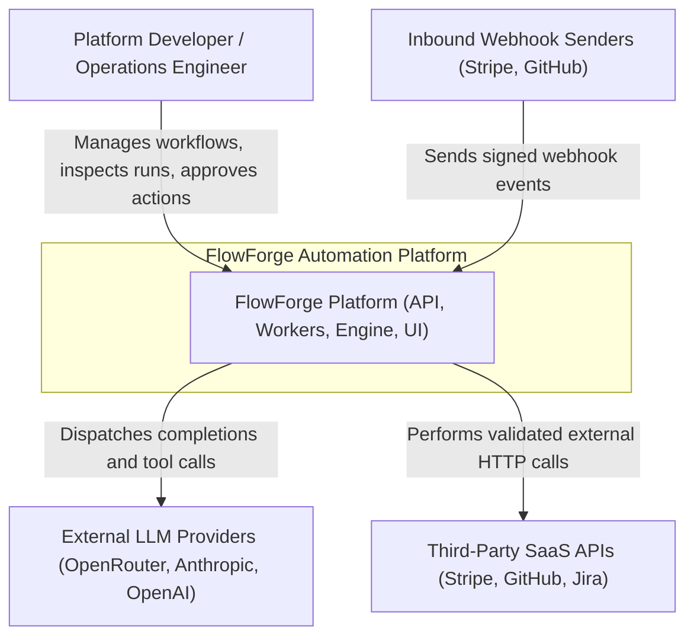
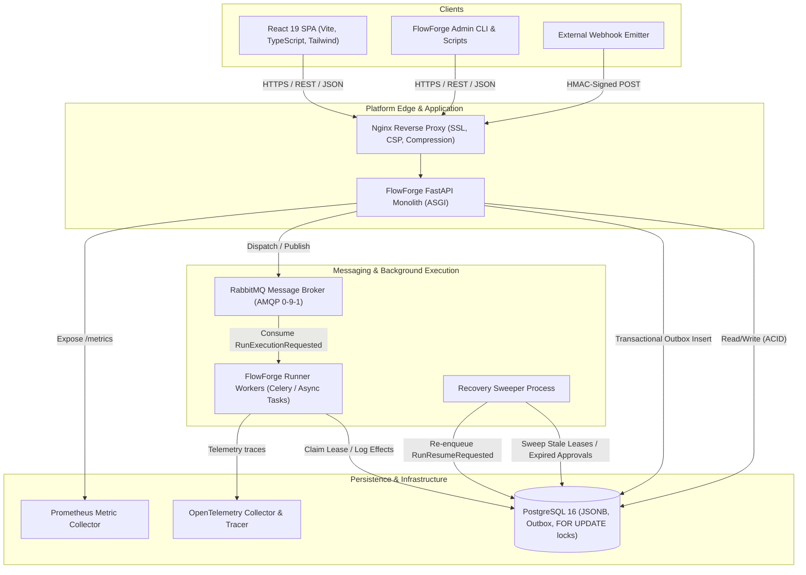
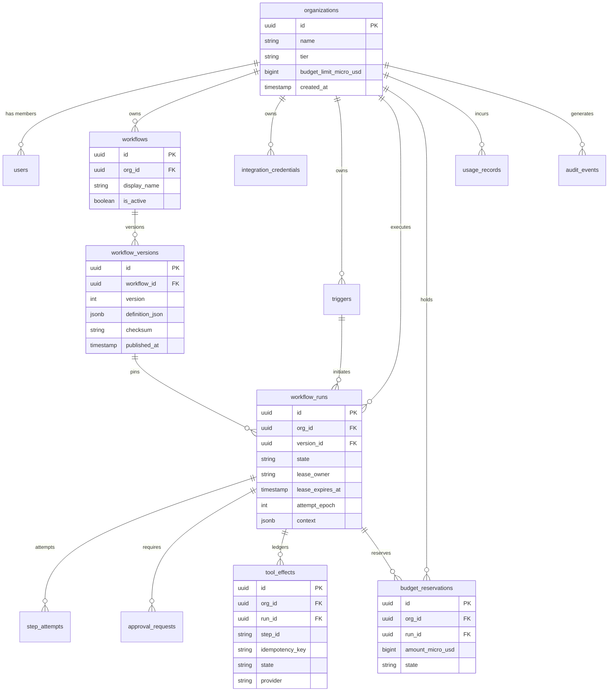
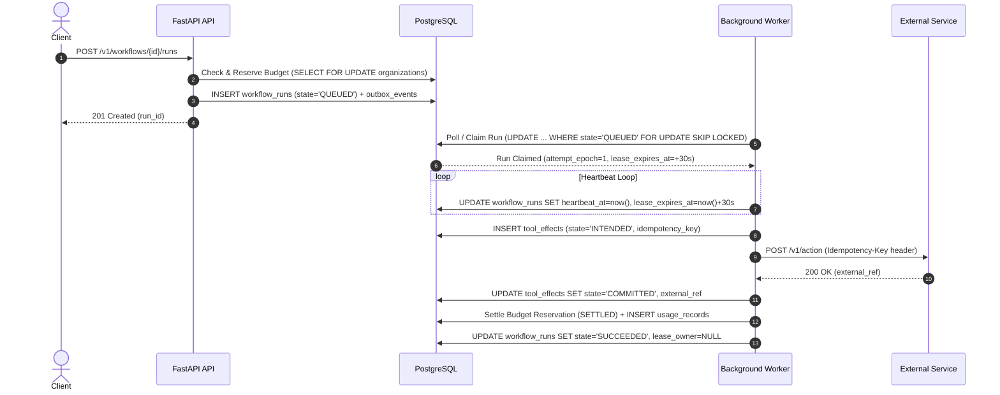
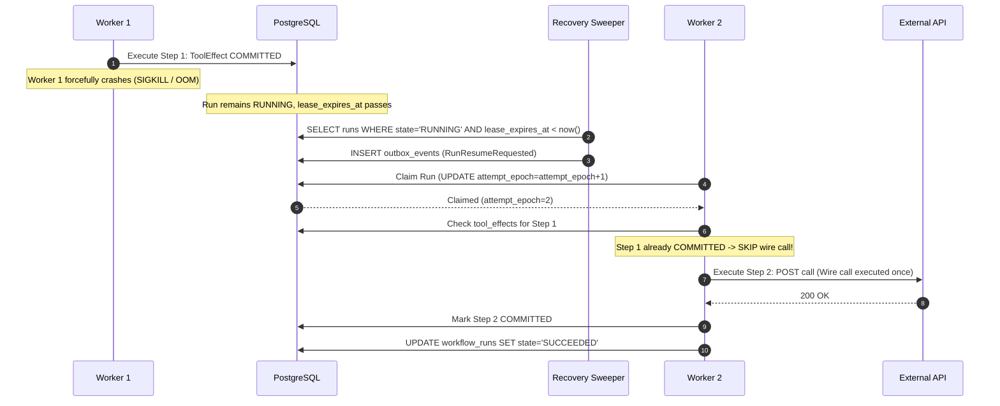

# FlowForge Architecture Diagrams

This document contains the structural C4 diagrams, Entity-Relationship Diagram (ERD), and core sequence diagrams for the FlowForge platform.

---

## 1. C4 Context Diagram (System Context)

---

## 2. C4 Container Diagram (Architecture Topology)

---

## 3. C4 Component Diagram (FastAPI Modular Monolith)

```mermaid
flowchart TD
    subgraph API Modules
        AuthRouter["Auth Router (/v1/auth)"]
        OrgRouter["Organizations Router (/v1/organizations)"]
        WorkflowRouter["Workflows Router (/v1/workflows)"]
        RunRouter["Executions Router (/v1/runs)"]
        ApprovalRouter["Approvals Router (/v1/approvals)"]
        TriggerRouter["Triggers Router (/v1/triggers, /v1/webhooks)"]
        UsageRouter["Usage & Budget Router (/v1/usage)"]
        AuditRouter["Audit Router (/v1/audit)"]
    end

    subgraph Core Services & Cross-Cutting
        RateLimiter["RateLimitMiddleware (Sliding Window)"]
        SecurityValidator["SSRF Egress Validator & IP Pinner"]
        BudgetManager["Two-Phase Budget Reservation Manager"]
        AuditLogger["Audit Event Logger"]
        HMACVerifier["Webhook HMAC-SHA256 Verifier"]
    end

    subgraph Persistence Repositories
        WorkflowRepo["WorkflowRepository"]
        RunRepo["ExecutionRepository"]
        ToolLedger["ToolEffectsRepository"]
        BudgetRepo["BudgetReservationRepository"]
    end

    WorkflowRouter --> WorkflowRepo
    RunRouter --> RunRepo
    RunRouter --> BudgetManager
    ApprovalRouter --> RunRepo
    TriggerRouter --> HMACVerifier
    TriggerRouter --> RunRepo

    RunRepo --> ToolLedger
    BudgetManager --> BudgetRepo
```

---

## 4. Entity-Relationship Diagram (ERD)

---

## 5. Sequence Diagram: Run Execution & Durable State Transitions

---

## 6. Sequence Diagram: Kill-Worker Crash Recovery

