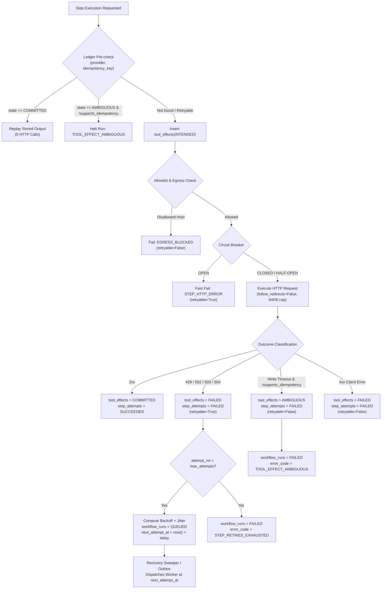

# FlowForge Failure Recovery Architecture

This document describes the durable failure modes, recovery mechanisms, and safety guarantees enforced by the FlowForge workflow automation engine.

---

## 1. Failure Modes & Mitigations

| Failure Mode | Root Cause | Engine Mitigation |
|---|---|---|
| **Worker Crash Mid-Step** | Host termination, SIGKILL, or OOM during step execution | Worker lease expires (`lease_expires_at < now()`). The recovery sweeper identifies the expired lease and inserts an outbox `RunResumeRequested` event. Worker 2 reclaims the lease (`attempt_epoch + 1`), checks `tool_effects`, skips external network calls if already `COMMITTED`, and resumes smoothly. |
| **Upstream 503 / Rate Limits (429)** | Downstream provider overloaded or rate limited | Step classified as retryable. Bounded exponential backoff with full jitter and `Retry-After` header adherence (capped at 120s) schedules `next_attempt_at`. Run returns to `QUEUED` without holding worker resources. |
| **Unrecoverable Tool Ambiguity** | Server drops connection or times out on non-idempotent write request (`effect="write"`) | If `provider_supports_idempotency: false`, re-sending the request could double-charge or duplicate external records. The ledger records `tool_effects(AMBIGUOUS)` and the run halts immediately with `error_code='TOOL_EFFECT_AMBIGUOUS'` without sending a second POST. |
| **Egress Policy Violation** | Workflow attempts to connect to internal or non-allowlisted host | Allowlist enforced prior to socket initialization. Fails immediately with `EGRESS_BLOCKED` (`retryable=False`). |
| **Cancel vs Execution Race** | User cancels a run (`POST /runs/{id}/cancel`) while a worker is actively executing a step | If `QUEUED`, run cancels immediately (R9). If `RUNNING`, API sets `cancel_requested=true` (R10). When the active step finishes, the worker detects `cancel_requested=true` at the step boundary and transitions cleanly to `CANCELLED` instead of advancing to subsequent steps. |

---

## 2. Tool-Effect Ledger Protocol

External HTTP calls are guarded by the atomic `tool_effects` table:
1. **Pre-check:** Before opening an HTTP socket, query `tool_effects` for `(provider, idempotency_key)`:
   - If `COMMITTED`: return stored summary immediately. Zero HTTP requests made.
   - If `AMBIGUOUS` on a non-idempotent write: halt immediately. Zero retry requests made.
   - Otherwise: commit `INTENDED` with `request_hash = sha256(canonical_json(...))` before network I/O.
2. **Post-execution:**
   - 2xx: update to `COMMITTED` with `external_ref` and `response_summary` (safe headers only; cookies and auth redacted).
   - Read/write timeout on non-idempotent write: update to `AMBIGUOUS`.
   - Other failures: update to `FAILED`.

---

## 3. Circuit Breaker Behavior

Per-provider circuit breaker tracks upstream availability:
- **CLOSED:** Normal operation. Failures increment error counter.
- **OPEN:** After 5 consecutive 5xx or timeout errors, circuit opens for 30 seconds. All subsequent requests fail fast with `STEP_HTTP_ERROR` without hitting the network.
- **HALF-OPEN:** After 30s cooldown, next request probes upstream. Success closes the breaker; failure re-opens it for 30s.

---

## 4. Manual Retries & State Machine

When a run is in `FAILED` state:
- An operator with `run.retry` permission issues `POST /v1/runs/{id}/retry`.
- State machine rule **R11** resets the run to `QUEUED` and enqueues an outbox `RunRequested` event in one transaction.
- Completed steps (`SUCCEEDED` in `step_attempts`) and committed side effects (`COMMITTED` in `tool_effects`) are preserved and skipped upon worker execution.
