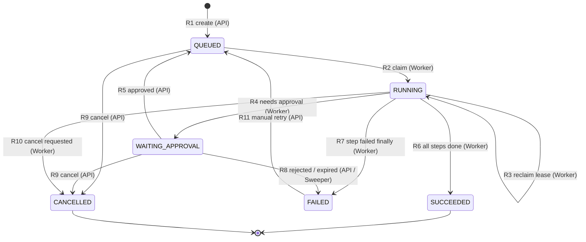
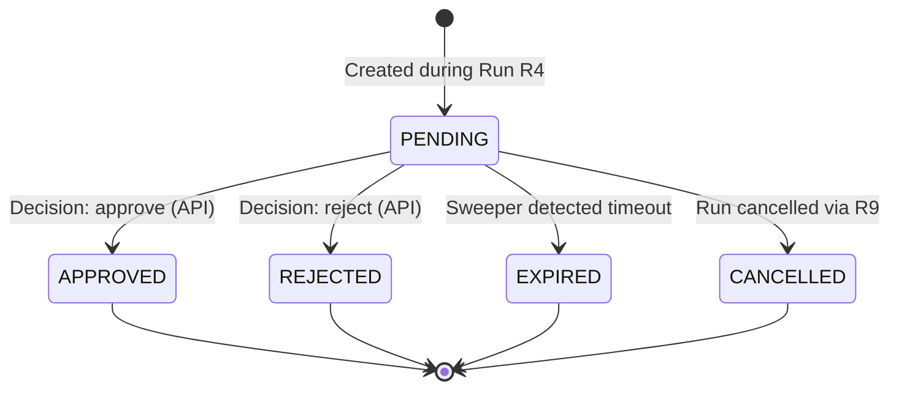
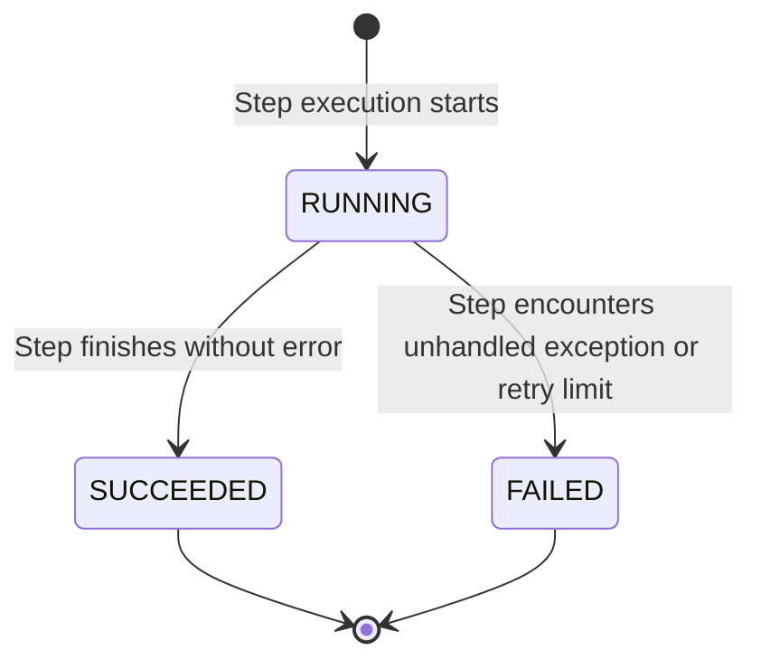
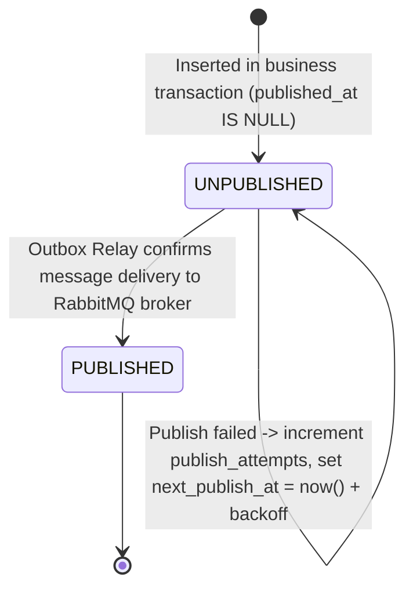

# Workflow Engine State Machines & Invariants

This document details the finite state machines governing workflow runs, human approvals, step attempts, and outbox event publishing in FlowForge. All state transitions must adhere to the single-statement guarded updates specified below.

---

## 1. Workflow Run State Machine (`workflow_runs.state`)

### 1.1 Mermaid Diagram



### 1.2 Transition Matrix

| Rule | From State | Event | To State | Initiating Actor | Guard Conditions | Atomic Single-Statement SQL Update | Side Effects & Outbox Events |
|---|---|---|---|---|---|---|---|
| **R1** | `[*] ` | `create` | `QUEUED` | API | Caller has `run.trigger`; organization under concurrency cap; workflow version is published | `INSERT INTO workflow_runs (...)` + `INSERT INTO outbox_events (aggregate_type, aggregate_id, event_type, payload) VALUES ('run', :id, 'RunRequested', ...)` in single DB transaction | Emits `RunRequested` outbox event |
| **R2** | `QUEUED` | `claim` | `RUNNING` | Worker | `next_attempt_at <= now() OR next_attempt_at IS NULL` | `UPDATE workflow_runs SET state='RUNNING', lease_owner=:worker_id, lease_expires_at=now() + :lease_dur, heartbeat_at=now(), attempt_epoch=attempt_epoch+1, started_at=COALESCE(started_at, now()) WHERE id=:id AND state='QUEUED'` (rowcount must be 1) | Increments `attempt_epoch` to fence stale workers |
| **R3** | `RUNNING` | `reclaim` | `RUNNING` | Worker | `lease_expires_at < now()` | Same as R2, with `WHERE id=:id AND state='RUNNING' AND lease_expires_at < now()` (rowcount must be 1) | New epoch invalidates prior worker instance |
| **R4** | `RUNNING` | `needs approval` | `WAITING_APPROVAL` | Worker | Epoch matches | `UPDATE workflow_runs SET state='WAITING_APPROVAL', lease_owner=NULL, lease_expires_at=NULL, current_step_id=:step_id WHERE id=:id AND state='RUNNING' AND attempt_epoch=:epoch` | Inserts `approval_requests` row in same transaction |
| **R5** | `WAITING_APPROVAL` | `approved` | `QUEUED` | API | Approval row transitioned to `APPROVED` in same transaction | `UPDATE workflow_runs SET state='QUEUED', next_attempt_at=now() WHERE id=:id AND state='WAITING_APPROVAL'` | Emits `RunResumeRequested` outbox event |
| **R6** | `RUNNING` | `all steps done` | `SUCCEEDED` | Worker | Epoch matches; `cancel_requested = false` | `UPDATE workflow_runs SET state='SUCCEEDED', outputs=:outputs, finished_at=now(), lease_owner=NULL WHERE id=:id AND state='RUNNING' AND attempt_epoch=:epoch` | Records final usage settle; terminal state |
| **R7** | `RUNNING` | `step failed finally` | `FAILED` | Worker | Epoch matches | `UPDATE workflow_runs SET state='FAILED', error_code=:code, error_detail=:detail, finished_at=now(), lease_owner=NULL WHERE id=:id AND state='RUNNING' AND attempt_epoch=:epoch` | Terminal unless retried via R11 |
| **R8** | `WAITING_APPROVAL` | `rejected / expired` | `FAILED` | API / Sweeper | Approval row is `REJECTED` or `EXPIRED` | `UPDATE workflow_runs SET state='FAILED', error_code=CASE WHEN :decision='REJECTED' THEN 'APPROVAL_REJECTED' ELSE 'APPROVAL_EXPIRED' END WHERE id=:id AND state='WAITING_APPROVAL'` | Terminal state |
| **R9** | `QUEUED`, `WAITING_APPROVAL` | `cancel` | `CANCELLED` | API | Caller has `run.cancel` permission | `UPDATE workflow_runs SET state='CANCELLED', cancel_requested=true, finished_at=now() WHERE id=:id AND state IN ('QUEUED', 'WAITING_APPROVAL')` | Cancels any pending `approval_requests`; terminal state |
| **R10** | `RUNNING` | `cancel requested` | `CANCELLED` | Worker (at step boundary) | `cancel_requested = true`; epoch matches | `UPDATE workflow_runs SET state='CANCELLED', finished_at=now(), lease_owner=NULL WHERE id=:id AND state='RUNNING' AND attempt_epoch=:epoch` | Terminal state |
| **R11** | `FAILED` | `retry` | `QUEUED` | API | Caller has `run.retry`; run not cancelled | `UPDATE workflow_runs SET state='QUEUED', error_code=NULL, error_detail=NULL, finished_at=NULL, next_attempt_at=now() WHERE id=:id AND state='FAILED'` | Emits `RunRequested` outbox event; already succeeded steps are preserved and skipped |

---

## 2. Approval Request State Machine (`approval_requests.state`)

### 2.1 Mermaid Diagram



### 2.2 Transition Matrix

| From State | Event | To State | Initiator | Guard Condition & Atomic SQL |
|---|---|---|---|---|
| `PENDING` | `approve` | `APPROVED` | User (Reviewer/Admin/Owner) | `UPDATE approval_requests SET state='APPROVED', decided_by=:user_id, decided_at=now(), decision_comment=:comment WHERE id=:id AND state='PENDING' AND expires_at > now()` |
| `PENDING` | `reject` | `REJECTED` | User (Reviewer/Admin/Owner) | `UPDATE approval_requests SET state='REJECTED', decided_by=:user_id, decided_at=now(), decision_comment=:comment WHERE id=:id AND state='PENDING' AND expires_at > now()` |
| `PENDING` | `expire` | `EXPIRED` | Expiration Sweeper | `UPDATE approval_requests SET state='EXPIRED' WHERE id=:id AND state='PENDING' AND expires_at <= now()` |
| `PENDING` | `run cancelled` | `CANCELLED` | System (Run cancel) | Executed in the run cancellation transaction (`R9`) |

---

## 3. Step Attempt State Machine (`step_attempts.status`)

### 3.1 Mermaid Diagram



### 3.2 Invariants

- **Immutability:** Step attempt rows are strictly append-only. Once `ended_at` and `duration_ms` are populated, rows are never modified.
- **Retries:** When a step fails and retry policy specifies an additional attempt, a **new row** is inserted with `attempt_no = attempt_no + 1`.
- **Unique Constraint:** `(run_id, step_id, attempt_no)` is enforced by a unique database constraint.

---

## 4. Transactional Outbox State Machine (`outbox_events.published_at`)

### 4.1 State Flow



### 4.2 Invariants

1. **At-Least-Once Delivery:** The worker must consume idempotently because network timeouts or crashes can cause redelivery.
2. **Deterministic Locking:** Publisher retrieves batches using:
   ```sql
   SELECT id, aggregate_id, event_type, payload
   FROM outbox_events
   WHERE published_at IS NULL AND next_publish_at <= now()
   ORDER BY id
   LIMIT 100
   FOR UPDATE SKIP LOCKED;
   ```
3. **Publication Ack:** Upon receiving publisher-confirm acknowledgment from RabbitMQ, mark `published_at = now()`.
